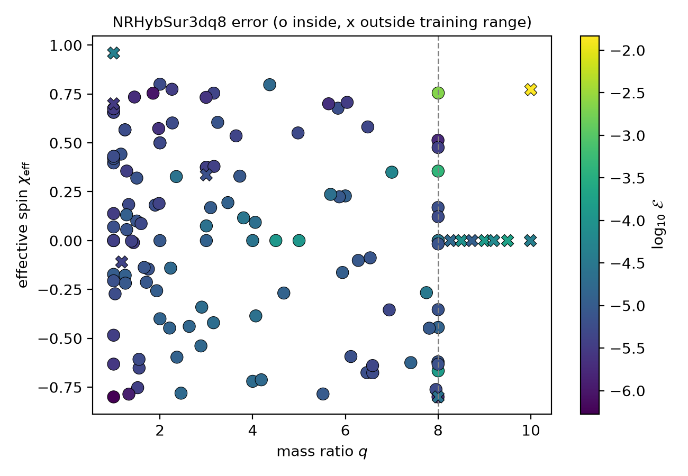
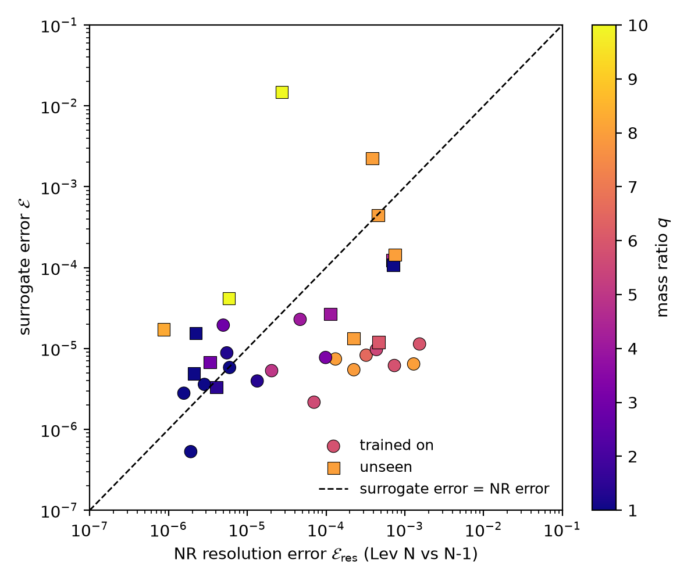
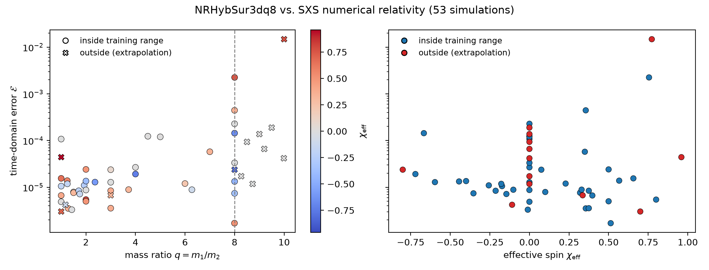

# Where do surrogate waveform models stop agreeing with numerical relativity?

Surrogate models such as **NRHybSur3dq8** reproduce binary black-hole
waveforms from the SXS numerical-relativity (NR) catalog in milliseconds
instead of the months a simulation takes. They are trained on a limited
range of mass ratios and spins (NRHybSur3dq8: q ≤ 8, |χ| ≤ 0.8). This project
measures NRHybSur3dq8 against 133 aligned-spin SXS simulations, inside its
training range and beyond it (up to q = 10, |χ| = 0.96), and checks every
result against the simulations' own numerical error.

## Results

1. **The surrogate has an accuracy floor of about 10⁻⁵.** Inside its training
   range the median error is ~10⁻⁵. Where the simulations themselves are less
   accurate than that (mostly high mass ratio), the surrogate matches them to
   within their own resolution error.
2. **It fits its training data more closely than it predicts new data.** On
   the 89 simulations it was trained on (SXS:BBH:1419–1509) the error never
   exceeds 3.4 × 10⁻⁵ (median 7 × 10⁻⁶). On 31 unseen simulations inside the
   same range the median is 1.4 × 10⁻⁵ and the maximum 2.2 × 10⁻³
   (Mann–Whitney p = 6 × 10⁻⁶). Most of that gap is below the NR resolution
   error, so it is statistically clear but physically small.
3. **Extrapolating in spin alone is safe; in mass ratio alone it degrades
   gently.** Spins up to 0.96 at low q stay at the floor. Non-spinning
   binaries out to q = 10 stay near 10⁻⁵ to 10⁻⁴, though up to ~20× above the
   (very small) NR error.
4. **High mass ratio combined with large aligned spin is where it breaks.**
   At q = 8, χ_eff = 0.76 (inside the training range) the error is 2.2 × 10⁻³,
   6× the NR resolution error; at q = 10, χ_eff = 0.77 it is 1.5 × 10⁻²,
   ~540× the NR resolution error.

| | |
|---|---|
|  |  |
| Error over the (q, χ_eff) plane. ○ inside, × outside the training range. | Surrogate error vs NR resolution error. Above the line: the surrogate is worse than the simulation's own uncertainty. |



## Method

For each SXS simulation:

1. Load the NR modes h_ℓm (ℓ ≤ 4) and the binary's parameters at the
   simulation's reference time (after junk radiation).
2. Evaluate the surrogate at the same parameters, starting just below the NR
   starting frequency.
3. Align: put the peak of the total amplitude at t = 0, then fit a small time
   shift, a rotation about the z-axis, and an overall sign.
4. Compute the time-domain error from the reference time to 100 M after the
   peak (Varma et al. 2019):

   E = ½ Σ_ℓm ∫ |h_NR − h_sur|² dt / Σ_ℓm ∫ |h_NR|² dt

5. Estimate the NR error floor by comparing the simulation's two highest
   resolutions with the same alignment and error measure (`resolution.py`).
   This is the standard, somewhat pessimistic estimate.

The alignment and error code is tested on synthetic waveforms with known time
shifts, rotations, sign flips and amplitude errors (`tests/test_core.py`).

## Things I found along the way

* **Sign convention.** gwsurrogate and the SXS catalog differ by an overall
  sign (h vs −h). A rotation can hide this in the dominant (2,2) mode, since
  a 90° rotation flips the phase of m = 2, but it leaves mode (ℓ, m) off by
  (m − 2) × 90°. The first runs showed E ≈ 10⁻² with a near-perfect (2,2)
  mode; a per-mode breakdown (`diagnose.py`) traced it to this, and fitting
  the sign lowered E ~700×.
* **Memory modes.** Current SXS waveforms include gravitational-wave memory
  in the m = 0 modes, which the surrogate does not model, so m = 0 modes are
  left out of E by default (`--include-m0` adds them).
* **Training-set overlap.** Testing a surrogate on its own training
  simulations overstates its predictive accuracy (result 2).
* **Reference accuracy.** Without the NR error floor, the q = 8 trained/unseen
  differences would look like model failures; most are within NR error
  (result 1).

## Usage

```bash
pip install -r requirements.txt
python tests/test_core.py                       # checks on synthetic waveforms

python run.py --auto 40 --q-max 10              # spread over the catalog
python run.py --auto 15 --q-min 8 --q-max 10    # extrapolation region
python run.py --sims $(python -c "print(' '.join(f'SXS:BBH:{i:04d}' for i in range(1419, 1510)))")

python plot.py results/NRHybSur3dq8.csv         # error vs q and χ_eff
python plot_map.py results/NRHybSur3dq8.csv     # error map
python training_split.py                        # trained-on vs unseen
python resolution.py --from-results 30          # NR error floor
python plot_floor.py
python diagnose.py SXS:BBH:2786                 # per-mode breakdown
```

The first run downloads the surrogate data (a few hundred MB) and each
simulation (cached in `~/.sxs/cache`). Results are appended to CSV files in
`results/`; rerunning skips simulations already done. gwsurrogate refuses
q > 10.01. The "cannot import LAL" message is harmless.

## Limitations and next steps

* 133 simulations; the high-q, high-spin corner has few points.
* The NR error estimate uses the two highest resolutions, so it is an upper
  bound for the highest-resolution waveform.
* Non-spinning unseen simulations sit near 10⁻⁴, above their spinning
  neighbours; a fixed-length comparison window would test whether long
  simulations simply accumulate more phase error.
* Next: mismatch with a detector noise curve as a function of total mass, and
  precessing systems with NRSur7dq4 (needs full 3D frame alignment).

## References

* V. Varma et al., *Surrogate model of hybridized numerical relativity binary
  black hole waveforms*, Phys. Rev. D 99, 064045 (2019).
* SXS Collaboration catalog, via the `sxs` Python package (catalog v3.0.0).
* `gwsurrogate` Python package.

Nishtha Kothari · Penn State · nfk5335@psu.edu
